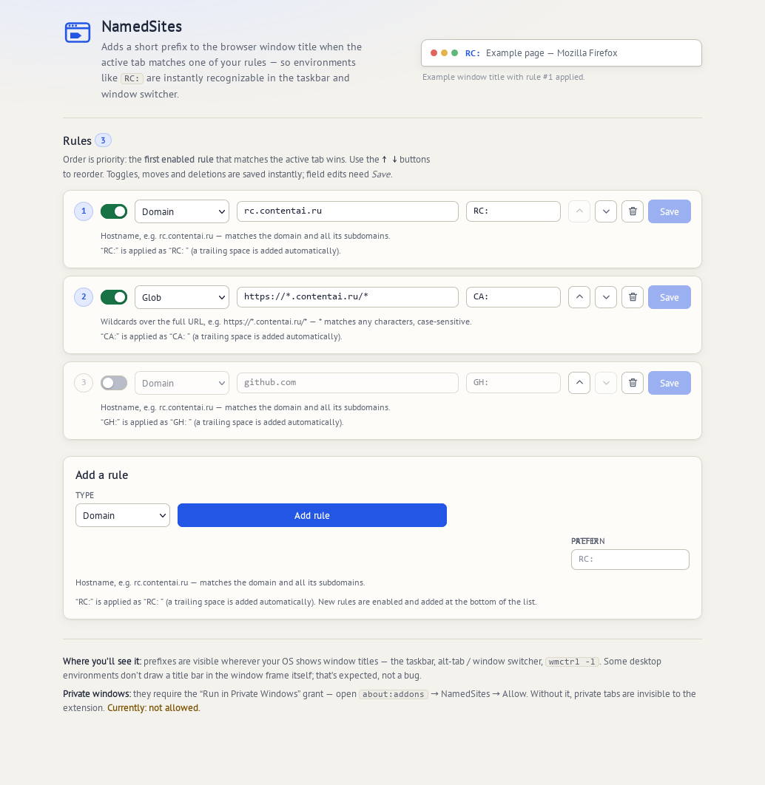
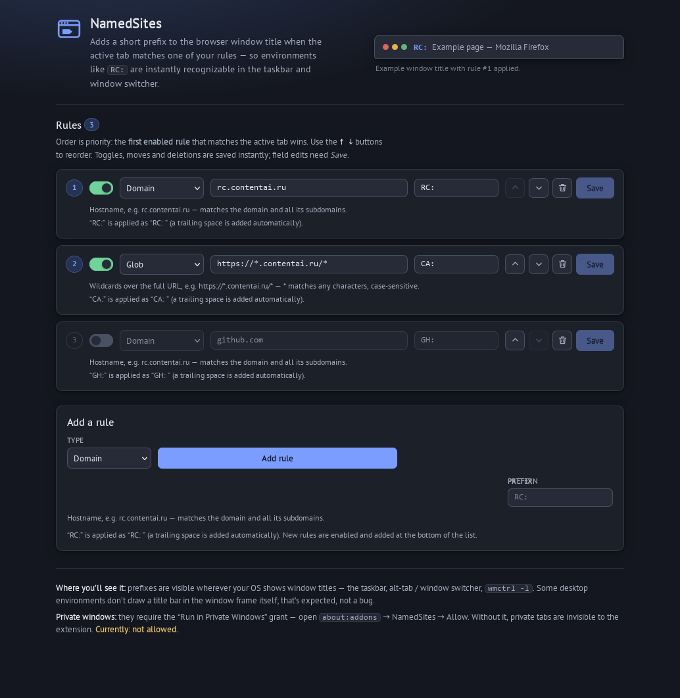

# NamedSites

A Firefox extension that adds a custom prefix to the **browser window title**
when the active tab matches one of your rules.

Example: with the rule `rc.contentai.ru → RC:`, a window whose active tab is on
`rc.contentai.ru` is titled `RC: Яндекс Почта — Mozilla Firefox` instead of
`Яндекс Почта — Mozilla Firefox`. The prefix is visible wherever your OS shows
window titles: the taskbar, the alt-tab switcher, `wmctrl -l`, etc.

Requires **Firefox 142 or newer**, desktop only — the `titlePreface` API is not
available on Firefox for Android.

## Screenshots

The options page, where you manage the rules (light and dark themes):





## Features

- **Per-window, dynamic prefixes** — applied and removed as you switch tabs,
  navigate, open/close tabs and windows. Each window is handled independently.
- **Two rule types**
  - `domain` — the tab's hostname equals the pattern or is a subdomain of it
    (`rc.contentai.ru` matches `rc.contentai.ru` and `*.rc.contentai.ru`).
  - `glob` — wildcard `*` over the full URL, e.g. `https://*.contentai.ru/*`
    (`*` matches any characters, case-sensitive, anchored at both ends).
- **First match wins** — the first enabled rule in list order is applied;
  reorder rules with the up/down buttons.
- **Live updates** — edits in the options page apply instantly, no browser
  restart needed. Rules persist between sessions.
- **Example rule out of the box** — `rc.contentai.ru → RC:` is created on first
  install; edit or delete it like any other rule.
- Firefox-only (uses the Firefox-specific `titlePreface` API). No frameworks,
  no build step, no runtime dependencies.

## Pairs with Quake Windows (KWin)

NamedSites is intended to be used together with
[Quake Windows](https://github.com/coordinatio/kwin-quake-windows) — a KWin
script (KDE Plasma 6) that makes any window a quake-style drop-down toggled by
a hotkey. Quake Windows recognizes windows by **regular expressions over the
window title** (up to 7 windows, each with its own hotkey).

Raw page titles are a fragile thing to match: they change with the page,
unread counts and notifications. NamedSites provides a **reliable anchor** —
a fixed prefix at the very start of the window title, present for as long as
the window's active tab is on a matching site.

Example: keep the rule `rc.contentai.ru → RC:`, then in a Quake Windows slot
enter the regex `^RC: ` (note the trailing space) and bind a hotkey. That
hotkey now toggles the window currently showing `rc.contentai.ru`, whatever
its page title says. The anchor follows the active tab: switch the window to
another site and the prefix disappears.

Matching tips — Quake Windows regexes are case-sensitive and search anywhere
in the title:

- Anchor the prefix with `^` so only the start of the title counts.
- Include the trailing space (`^RC: `) to avoid matching lookalike prefixes.
- Give each site group its own prefix to drive different hotkeys.

## Installation

### Temporary (development)

Requires [Node.js](https://nodejs.org/) 20+ (for the `web-ext` dev tooling):

```sh
npm install
npm run run          # web-ext run: launches Firefox with the extension loaded
```

Or load it manually: `about:debugging` → **This Firefox** → **Load Temporary
Add-on…** → pick `src/manifest.json`. Temporary add-ons last until the browser
restarts.

### Permanent

**Easiest — use the signed release:** download `namedsites-<version>.xpi` from
the [Releases page](https://github.com/coordinatio/NamedSites/releases), then
install it via `about:addons` → gear ⚙ → **Install Add-on From File…**. It is
signed by Mozilla (unlisted channel), works on release Firefox, and persists
across restarts.

Or build it yourself:

- **Firefox Developer Edition / Nightly / ESR**: set
  `xpinstall.signatures.required=false` in `about:config`, then build and
  install the package:

  ```sh
  npm run build      # produces web-ext-artifacts/namedsites-<version>.zip
  ```

  Rename the `.zip` to `.xpi` and open it with Firefox (or install via
  `about:addons` → gear menu → **Install Add-on From File…**).

- **Release / Beta Firefox**: the extension must be signed by Mozilla. The
  simplest path is unlisted signing via AMO (requires an API key/secret from
  <https://addons.mozilla.org/developers/addon/api/key/>):

  ```sh
  npx web-ext sign --source-dir src --channel unlisted \
      --api-key "$WEB_EXT_API_KEY" --api-secret "$WEB_EXT_API_SECRET"
  ```

  Install the signed `.xpi` from `web-ext-artifacts/`.

## Managing rules

Open the options page: `about:addons` → **NamedSites** → **Preferences**
(the page can also be opened in a full tab).

Each rule has:

| Field     | Meaning                                                        |
| --------- | -------------------------------------------------------------- |
| `enabled` | Disabled rules are skipped.                                     |
| `type`    | `domain` (hostname + subdomains) or `glob` (full-URL wildcard). |
| `pattern` | The hostname or URL pattern to match.                           |
| `prefix`  | Text prepended to the window title, e.g. `RC:`.                 |

Leading and trailing whitespace is trimmed when you save a rule; a single
trailing space is then added automatically when the prefix is applied
(`RC:` → `RC: `).

Rules are kept in `browser.storage.local` under the key `rules`
(with `schemaVersion: 1`):

```json
{
  "schemaVersion": 1,
  "rules": [
    {
      "id": "…",
      "type": "domain",
      "pattern": "rc.contentai.ru",
      "prefix": "RC:",
      "enabled": true
    }
  ]
}
```

## Private windows

By default Firefox does not let extensions see private windows. To prefix
private windows too, enable **Run in Private Windows** for NamedSites in
`about:addons`. Without the grant, private windows are silently ignored.

## Notes & limitations

- The prefix is shown wherever the OS renders window titles. Some desktop
  environments do not draw a title in the window frame itself — that is not an
  extension bug.
- On Windows the prefix may not appear while the page has no title
  (e.g. `about:blank`) — Firefox bug
  [1387425](https://bugzilla.mozilla.org/show_bug.cgi?id=1387425).
- Other extensions that set `titlePreface` (containers, tab managers) write the
  same window property; last write wins.
- Prefixes do not survive a browser restart by themselves; NamedSites
  re-applies them on startup.
- Internationalized (non-ASCII) domains must be entered as punycode
  (e.g. `xn--e1afmkfd.xn--p1ai` for `пример.рф`) — the browser reports
  hostnames in punycode.
- IPv6 hosts cannot be matched by `domain` rules; use a `glob` rule such as
  `http://[::1]/*`.
- Rules are stored as a single list. Edit them in one options tab at a time —
  simultaneous edits in two tabs can overwrite each other (last write wins).

## Development

```sh
npm test             # unit tests for the rule matcher (node:test)
npm run lint         # web-ext lint
npm run build        # build the extension package
npm run run          # run in a temporary Firefox profile
```

Project layout:

```
src/
├── manifest.json      # MV3, background event page
├── background.js      # tab/window events -> titlePreface engine
├── matcher.js         # pure matching functions (shared with tests & UI)
├── options/           # options page (vanilla HTML/CSS/JS)
└── icons/
tests/
└── matcher.test.js
docs/
└── screenshots/       # options-page screenshots used in this README
```

### Manual smoke checklist

1. Load the extension; the example rule `rc.contentai.ru → RC:` appears in the
   options page.
2. Open a matching site — the window title gains the `RC: ` prefix; switch to a
   non-matching tab — it disappears.
3. Open two windows on different sites — each shows its own prefix.
4. Add / edit / disable / reorder / delete rules — changes apply immediately,
   no browser restart.
5. Close the active matched tab — the prefix recomputes from the new active tab.
6. Restart Firefox — rules persist and prefixes re-apply.